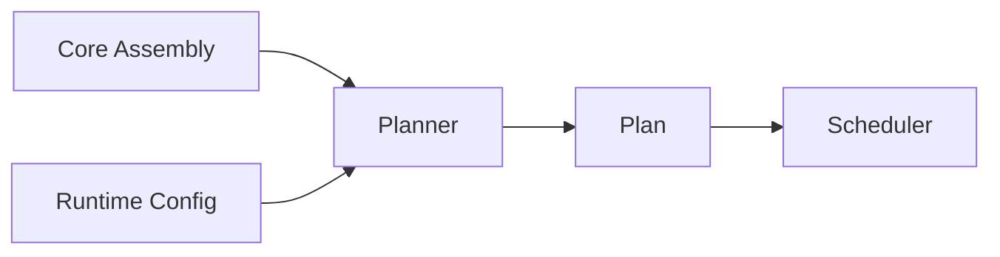
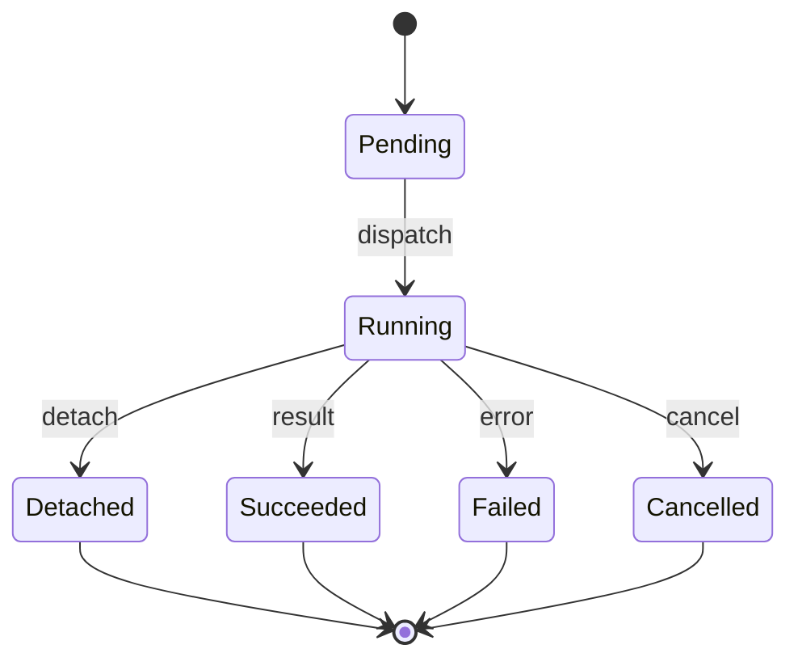

N.O.R.E. executes assemblies in three phases: planning, scheduling, and execution. Each phase has clear inputs and outputs, and failures are handled explicitly at every stage.

## Planning

The planner (`planner.Compiler`) turns a core assembly into a plan. The plan is a deterministic, ordered set of steps derived from the assembly's bindings and the resolved runtime config.

The planner:

- Resolves capability references to their runtime descriptors.
- Applies runtime config defaults at plan time.
- Produces a plan that the scheduler can execute without re-resolving.

<Note>
Runtime config is resolved once per plan. Defaults are applied at plan time, not at execution time. This means the plan is self-contained and reproducible.
</Note>

## Scheduling

The scheduler executes plan steps over the event bus. Each step is a capability invocation. The scheduler:

- Dispatches invocations to the appropriate capability runtime.
- Tracks execution state through a state machine (`Execution`, `Scheduler`, `CapabilityRuntimeEngine`, `ScopeRegistry`).
- Snapshots execution state for recovery.

The event bus decouples scheduling from execution. The scheduler publishes events; capability runtimes consume them and report results back.

## Executing one capability

A single capability invocation follows this lifecycle:

| State | Meaning |
| --- | --- |
| `Pending` | The invocation is queued but not yet dispatched. |
| `Running` | The capability runtime is executing the invocation. |
| `Succeeded` | The capability runtime returned a successful result. |
| `Failed` | The capability runtime returned an error or the invocation timed out. |
| `Cancelled` | The invocation was cancelled before completion. |
| `Detached` | The invocation was detached and is now tracked as a separate child execution. |

## Failure semantics

**One failure fails the execution.** If any capability invocation fails, the execution stops and is marked as failed. There is no partial success.

Failures are categorized as:

- **In-band errors** — the capability runtime returned a structured error (`response.error`). The capability runtime is still healthy.
- **Transport failures** — the capability runtime could not be reached, crashed, or timed out. The capability runtime may be unhealthy.

<Warning>
A transport failure is not the same as an in-band error. An in-band error means the capability runtime executed and reported a problem. A transport failure means the capability runtime could not execute at all.
</Warning>

## Cancellation vs failure

Cancellation and failure are distinct:

- **Cancelled** — you or the system stopped the execution before it completed. Cancellation is graceful; the capability runtime is asked to stop and the execution is marked cancelled.
- **Failed** — the execution stopped because something went wrong. The capability runtime reported an error, timed out, or became unreachable.

A cancelled execution is not a failed execution. The state machine treats them as separate terminal states.

## Detach

Detaching an invocation creates a separately tracked child execution. The parent execution continues without waiting for the detached invocation. The child execution has its own lifecycle and can be queried independently.

Use detach when a capability's work should outlive the current execution — for example, a long-running background task.

## Retries and backoff

The planner supports retries with configurable backoff. A retry re-executes a failed invocation according to the retry policy:

- **Max attempts** — the maximum number of times to attempt the invocation.
- **Backoff** — the delay between attempts, optionally with exponential growth.

Retries apply to both in-band errors and transport failures. A retry that exhausts its attempts marks the invocation as failed.

## Timeouts and deadlines

Every invocation has a timeout. The timeout is enforced by the scheduler:

- If the capability runtime does not respond within the timeout, the invocation is marked as failed.
- A deadline is an absolute time by which the invocation must complete. If the deadline passes before the invocation finishes, it is cancelled.

Timeouts and deadlines are resolved at plan time from runtime config.

## CEL mapping and validation

Capability parameters are mapped and validated using CEL (Common Expression Language). The planner:

- Maps input parameters to the capability's expected schema.
- Validates parameters against CEL expressions defined in the capability's schema.
- Rejects invalid parameters before the invocation is dispatched.

CEL expressions are evaluated at plan time when possible, and at execution time when they depend on runtime state.

## Runtime config resolution

Runtime config is resolved once per plan. The resolution order is:

1. Defaults from the capability's schema.
2. Values from the assembly's runtime config.
3. Values from the project's runtime config.
4. Values from the execution request.

The resolved config is baked into the plan. The scheduler and capability runtimes see the final values, not the layered config.

## Next steps

<CardGroup cols={2}>
  <Card title="Providers" icon="plug" href="/architecture/providers">
    How capability runtimes are hosted and dispatched.
  </Card>
  <Card title="Architecture Overview" icon="workflow" href="/architecture/overview">
    The canonical pipeline and module structure.
  </Card>
  <Card title="Security" icon="shield" href="/architecture/security">
    Transport security and isolation.
  </Card>
  <Card title="Persistence" icon="database" href="/architecture/persistence">
    How execution state is stored and recovered.
  </Card>
</CardGroup>
