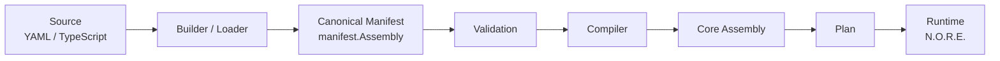

Neuron is a runtime for building and operating complex software systems from composable, executable capabilities. You author capabilities and assemblies in YAML or TypeScript, compile them into a canonical manifest, and execute them on N.O.R.E. (Neuron Operational Runtime Engine).

## The canonical pipeline

Every path through Neuron — YAML authoring, TypeScript SDK, or programmatic construction — converges on the same canonical manifest before execution.

The pipeline has two hard boundaries:

- **Authoring boundary.** Source files are parsed and loaded into `manifest.Assembly`. After this point, nothing depends on the original authoring format.
- **Compiler boundary.** The compiler turns the validated manifest into a core assembly — an intermediate representation the runtime can plan and execute. The runtime never sees source files.

## Design goals

In priority order:

1. **One canonical representation.** All authoring surfaces produce the same manifest. The compiler and runtime operate on that manifest alone.
2. **Explicit execution semantics.** Failure, cancellation, retries, and timeouts are first-class concepts in the model, not afterthoughts.
3. **Out-of-process isolation.** Capability runtimes execute in separate processes or sandboxes. A crash or hang in one capability runtime cannot corrupt the engine.
4. **Deterministic planning.** Given the same manifest and runtime config, the planner produces the same plan. Execution is reproducible.
5. **Composability.** Assemblies bind to capabilities. Capabilities are reusable across assemblies without modification.

## What lives where

Neuron is split into two Go modules that agree only through a shared package:

| Module | Responsibility |
| --- | --- |
| `application` | The `neuron` CLI. Authoring, building, validation, and project-level commands. |
| `nore` | The `nore` runtime binary. N.O.R.E. — planning, scheduling, execution, and the API server. |
| `shared` | The contract between them. Protocol definitions, manifest types, and wire schemas. |

<Info>
The two modules never import each other. All communication flows through `shared` types or the wire protocol. This keeps the CLI and runtime independently deployable.
</Info>

## Authoring surfaces

You can author assemblies and capabilities through multiple surfaces. Each surface produces the same canonical manifest:

- **YAML** — declarative authoring for assemblies, capabilities, and bindings.
- **TypeScript SDK** — programmatic authoring with typed helpers.
- **Go SDK** — for capability runtime implementers.

After the builder or loader runs, the rest of the pipeline is identical regardless of source.

## Compiler boundary

The compiler sits between validation and the runtime. It:

- Resolves capability references to their runtime descriptors.
- Applies runtime config defaults.
- Produces a core assembly — a self-contained intermediate representation.

The runtime receives the core assembly and a plan. It does not re-validate or re-resolve. This keeps the runtime fast and the compiler the single place where manifest semantics are interpreted.

## Module and capability runtime model

A **capability runtime** is the executable unit that performs a capability's work. N.O.R.E. hosts capability runtimes through providers:

- **Process provider** — gRPC worker pool or one-shot JSON stdio.
- **WASM provider** — wazero-based sandboxed execution.

Built-in capability runtimes (`neuron:core:set`, `ai`, `log`, `http`, `delay`, `command`) execute in-process. External capability runtimes execute out-of-process.

<Note>
The term is always "capability runtime." It refers to the hosted executable that performs a capability's work, whether in-process, out-of-process, or sandboxed.
</Note>

## Next steps

<CardGroup cols={2}>
  <Card title="Execution Model" icon="workflow" href="/architecture/execution-model">
    How N.O.R.E. plans, schedules, and executes assemblies.
  </Card>
  <Card title="Providers" icon="plug" href="/architecture/providers">
    How external capability runtimes are hosted.
  </Card>
  <Card title="Security" icon="shield" href="/architecture/security">
    Transport security, authentication, and isolation.
  </Card>
  <Card title="Persistence" icon="database" href="/architecture/persistence">
    Where Neuron stores build records and execution state.
  </Card>
</CardGroup>
