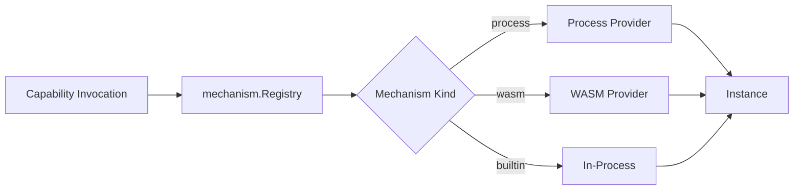

Providers host external capability runtimes. N.O.R.E. dispatches capability invocations to the right provider based on the capability's mechanism kind.

## Provider contract

Every provider implements the same contract:

| Interface | Responsibility |
| --- | --- |
| `Descriptor` | Describes the provider — name, supported mechanism kinds, and configuration schema. |
| `Spec` | The configuration for a specific capability runtime instance. |
| `Provider` | Manages the lifecycle of capability runtime instances — start, stop, health check. |
| `Instance` | A running capability runtime that can execute invocations. |

## Mechanism registry dispatch

The `mechanism.Registry` routes invocations to the correct provider. Each capability runtime declares its mechanism kind at registration:

- `process` — hosted by the process provider.
- `wasm` — hosted by the WASM provider.
- `builtin` — executed in-process by N.O.R.E. itself.

If no provider is registered for a mechanism kind, the invocation fails with an unsupported-kind error.

## Process provider

The process provider hosts capability runtimes as separate OS processes. Two modes are supported:

### gRPC worker pool

For long-running capability runtimes, the process provider maintains a pool of gRPC workers. Each worker is a persistent process that speaks `neuron/capability-runtime-v1` over a Unix socket.

- Workers are reused across invocations.
- The pool scales based on demand.
- Health checks detect and replace unhealthy workers.

### One-shot JSON stdio

For short-lived or script-based capability runtimes, the process provider spawns a one-shot process that speaks `neuron/capability-runtime-v1-json` over stdio.

- A new process is spawned for each invocation.
- The process reads newline-delimited JSON from stdin and writes responses to stdout.
- The process exits after the invocation completes.

<Note>
The gRPC worker pool is preferred for capability runtimes that execute many invocations. The one-shot JSON stdio mode is simpler to implement and suitable for low-volume or script-based runtimes.
</Note>

## WASM provider

The WASM provider hosts capability runtimes compiled to WebAssembly. It uses wazero — a pure-Go WebAssembly runtime — to execute WASM modules without CGO or external dependencies.

- WASM modules run in a sandboxed environment.
- The provider enforces resource limits (memory, execution time).
- Capability runtimes communicate with N.O.R.E. through the same wire protocol as process-based runtimes.

## Adapter boundary

The adapter (`plugin`) is the boundary between N.O.R.E. and external capability runtimes. It:

- Translates between N.O.R.E.'s internal invocation format and the wire protocol.
- Handles serialization and deserialization of parameters and results.
- Enforces timeouts and cancellation.

The adapter ensures that capability runtimes do not need to know about N.O.R.E.'s internals. They only implement the wire protocol.

## Timeouts

Every invocation through a provider has a timeout. The provider enforces the timeout:

- If the capability runtime does not respond within the timeout, the invocation is marked as failed.
- The provider may kill the underlying process or WASM instance if it does not stop gracefully.

Timeouts are resolved at plan time from runtime config.

## Health checks

Providers periodically health-check their instances:

- **Process provider** — sends a health check gRPC call or checks process liveness.
- **WASM provider** — verifies the WASM instance is still responsive.

Unhealthy instances are removed from the pool and replaced. Invocations are not dispatched to unhealthy instances.

## Graceful shutdown

When N.O.R.E. shuts down, providers stop their instances gracefully:

1. Stop accepting new invocations.
2. Wait for in-flight invocations to complete (up to a deadline).
3. Kill any remaining instances.
4. Close the provider.

<Warning>
Graceful shutdown has a deadline. If instances do not stop within the deadline, they are killed forcefully. In-flight invocations that do not complete are marked as failed.
</Warning>

## Unsupported kinds

If a capability declares a mechanism kind that no provider supports, the invocation fails immediately with an unsupported-kind error. The error includes the mechanism kind and the list of supported kinds.

Planned mechanism kinds:

- **container** — host capability runtimes in containers.
- **remote** — connect to capability runtimes over the network.

## Next steps

<CardGroup cols={2}>
  <Card title="Execution Model" icon="workflow" href="/architecture/execution-model">
    How invocations are scheduled and executed.
  </Card>
  <Card title="Wire Protocol" icon="file-code" href="/guides/wire-protocol">
    The gRPC and JSON protocols for capability runtime communication.
  </Card>
  <Card title="Security" icon="shield" href="/architecture/security">
    Transport security and isolation.
  </Card>
  <Card title="Architecture Overview" icon="layers" href="/architecture/overview">
    The canonical pipeline and module structure.
  </Card>
</CardGroup>
