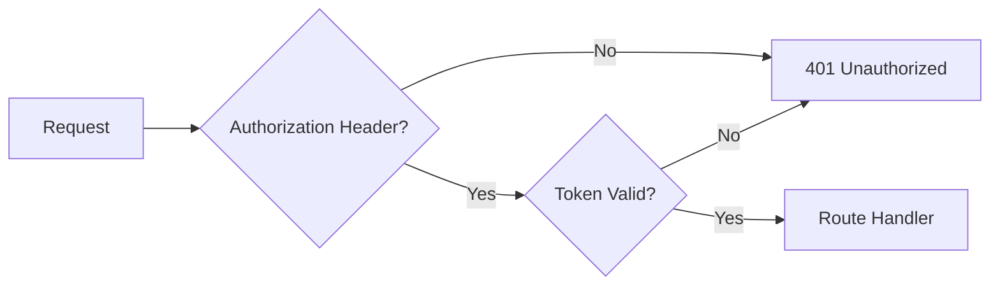

Neuron's security model covers transport security, authentication, and isolation. The design principle is defense in depth: no single control is trusted alone.

## Unix socket

The process provider communicates with capability runtimes over Unix sockets. Socket files are created with mode `0600` — readable and writable only by the owner.

- The socket path is not predictable by other users on the system.
- Filesystem permissions prevent unauthorized processes from connecting.
- Sockets are removed on graceful shutdown.

## Token authentication

All API routes require a token except `/health`. The token is a shared secret configured at startup.

- The token is passed in the `Authorization` header.
- Comparison uses constant-time comparison to prevent timing attacks.
- Requests without a valid token are rejected with `401 Unauthorized`.

<Warning>
The `/health` endpoint is intentionally unauthenticated. It is used by load balancers and orchestrators to check liveness. Do not expose sensitive information on this endpoint.
</Warning>

## Constant-time comparison

Token comparison uses constant-time comparison. This prevents an attacker from measuring response times to guess the token one byte at a time.

## TCP without token

If N.O.R.E. is configured to listen on TCP (for remote access), connections without a valid token are refused immediately. The connection is closed before any data is exchanged.

- TCP listeners require a token.
- Connections without a valid token are dropped.
- This applies to all routes, including `/health`, when TCP is enabled.

## Project runtime

The project runtime (started with `neuron`) binds to loopback TCP only. It does not listen on external interfaces.

- The port is auto-selected and written to a discovery record.
- The discovery record (`.neuron/runtime.json`) contains the port and token.
- The `neuron run` command reads this record to connect to the project runtime.

<Note>
The project runtime is designed for local development. For remote access, configure N.O.R.E. with a token and appropriate network controls.
</Note>

## Digest verification

Capability runtimes are content-addressed. Each capability runtime is identified by a digest — a cryptographic hash of its binary or module.

- Before execution, N.O.R.E. verifies the digest matches the expected value.
- A digest mismatch means the capability runtime has been tampered with or corrupted.
- Mismatched capability runtimes are not executed.

## Out-of-process isolation

External capability runtimes execute in separate processes or sandboxes:

- **Process provider** — each capability runtime is a separate OS process. A crash or memory corruption in one capability runtime does not affect N.O.R.E. or other capability runtimes.
- **WASM provider** — capability runtimes run in a wazero sandbox with resource limits. They cannot access the host system except through the wire protocol.

Built-in capability runtimes execute in-process. They are trusted because they ship with Neuron.

<Info>
Out-of-process isolation means a buggy or malicious capability runtime cannot corrupt N.O.R.E.'s memory. The worst case is a failed invocation, not a crashed engine.
</Info>

## Next steps

<CardGroup cols={2}>
  <Card title="Providers" icon="plug" href="/architecture/providers">
    How capability runtimes are hosted and isolated.
  </Card>
  <Card title="Persistence" icon="database" href="/architecture/persistence">
    Where capability runtimes are stored and verified.
  </Card>
  <Card title="Execution Model" icon="workflow" href="/architecture/execution-model">
    How invocations are dispatched to capability runtimes.
  </Card>
  <Card title="Architecture Overview" icon="layers" href="/architecture/overview">
    The canonical pipeline and module structure.
  </Card>
</CardGroup>
